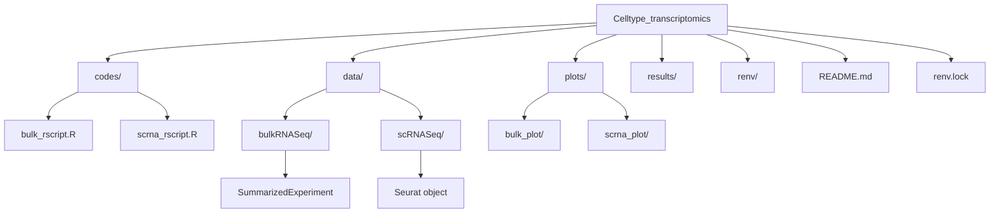

## Transcriptomic Characterisation of Human PBMC Immune-Cell Populations Using Bulk and Single-Cell RNA Sequencing
> **Master of Science (MSc) Thesis Project| Life Science Informatics**  
> **Author:** Joseph F Mendy  
> 
> **Institution:** Deggendorf Institute of Technology

### Project Overview:
This project investigates the transcriptomic characteristics of nine peripheral blood mononuclear cell (PBMC) immune-cell populations using bulk RNA sequencing (bulk RNA-seq), followed by further characterisation using single-cell RNA sequencing (scRNA-seq) and fluorescence-activated cell sorting (FACS)

The primary objective was to investigate the potential of bulk RNA-seq as a tool for characterising distinct immune-cell populations based on their gene-expression profiles

Single-cell transcriptomic analysis provided additional resolution of cellular heterogeneity and enabled the examination of cell-type-specific gene-expression patterns. FACS provided an additional experimental approach to characterising immune-cell populations using surface markers

Single-cell transcriptomic analysis provided additional resolution of cellular heterogeneity and enabled the examination of cell-type-specific gene-expression patterns. FACS provided another approach to characterising immune-cell populations using surface markers.

The project integrates experimental immunology with computational transcriptomics to investigate immune-cell identity and gene-expression signatures.

### Research Objectives 
1. Characterise nine PBMC immune-cell populations using bulk RNA-seq.
2. Identify differentially expressed genes and population-specific molecular signatures.
3. Further investigate immune-cell heterogeneity and marker expression using scRNA-seq.
4. Examine the correspondence between transcriptomic findings and established immune-cell markers.
5. Do the identified markers encode surface proteins used in the FACS panel? 

### Immune cells of interest
The bulk RNA-seq analysis investigated nine immune-cell populations:
- B cells
- Conventional dendritic cells type 1 (cDC1)
- Conventional dendritic cells type 2 (cDC2)
- Dendritic cells type 3 (DC3)
- Monocytes type 1 (mo1)
- Monocytes type 2 (mo2)
- Intermediate monocytes (moint)
- Plasmacytoid dendritic cells (pDC)
- Transitional dendritic cells (tDC)

The single-cell analysis enabled further examination of cellular heterogeneity and immune-cell subpopulations.
### Computational Workflow
1. Bulk RNA-seq Analysis
   - Expression data preparation and quality assessment
   - Gene filtering and data preprocessing
   - Variance-stabilising transformation
   - Principal component analysis (PCA)
   - Differential gene expression analysis using DESeq2
   - Identification of population-specific gene-expression signatures
   - Visualisation of differentially expressed genes

2. Single-Cell RNA-seq Analysis
   - Quality control and filtering
   - Doublet detection using scDblFinder
   - Data normalisation and highly variable gene selection
   - Dimensionality reduction using PCA and UMAP
   - Cell clustering and population characterisation
   - Identification of differentially expressed genes and cell-type markers
   - Visualisation of cellular heterogeneity

3. Experimental Characterisation
   - FACS was used as an additional experimental approach to examine immune-cell populations through established surface-   marker expression.

### Technologies and Tools
| Analysis Area | Tools | Purpose |
|---|---|---|
| Programming | R | Statistical computing |
| Bulk RNA-seq | DESeq2 | Differential gene expression |
| Single-cell RNA-seq | Seurat (Presto) | Single-cell analysis |
|Data manipulation| tidyverse, dplyr, tidyr|preprocessing|
| Data visualisation | ggplot2, ComplexHeatmap, patchwork | Generate scientific plots |
| Reproducibility | Git, GitHub, renv | Version control and reproducibility |

### Repository Structure

The single-cell Seurat object is approximately 7 GB.

### Running the Analysis
The analysis scripts are designed to run sequentially in the same R session.

##### Step 1: Bulk RNA-seq analysis
source("codes/bulk_rscript.R")

##### Step 2: Single-cell RNA-seq analysis
source("codes/scrna_rscript.R")

Run the bulk analysis first because the current single-cell workflow depends on intermediate objects generated during the bulk analysis.

### Output Files
The analysis generates plots, tables, and intermediate results in the project directories:

- plots/bulk_plot/ – Bulk RNA-seq visualisations.

- plots/scrna_plot/ – Single-cell RNA-seq visualisations.

- results/ – Intermediate analysis objects and results.

### Software and Data Releases
- GitHub source code: https://github.com/JFMendy/Celltype_transcriptomics
- Software release: Zenodo DOI: 10.5281/zenodo.22211143
- Processed datasets: Zenodo DOI: 10.5281/zenodo.21398652
  
### Research Significance
This project demonstrates the application of computational transcriptomics to immune-cell characterisation, combining bulk and single-cell RNA sequencing with experimental immunophenotyping.

It highlights the use of statistical analysis, differential gene expression, dimensionality reduction, clustering and molecular marker identification to investigate immune-cell identity.

### Author
Joseph F. Mendy
MSc Life Science Informatics

MSc Molecular Biology

Research interests: Bioinformatics, Computational Biology, Computational Immunology, Transcriptomics, and Infectious Disease Research.

